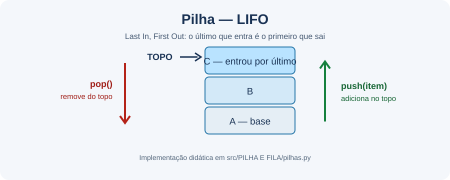

# Conceitos de algoritmos e estruturas de dados

Este guia complementa [Fundamentos de Python](../Fundamentos/FUNDAMENTOS.md): aqui o foco é escolher e compreender a estrutura usada para representar os dados, e não apenas a sintaxe da linguagem.

## 1. Algoritmo e estrutura de dados

Um algoritmo é uma sequência finita de passos que transforma uma entrada em uma saída. A estrutura de dados define como as informações ficam organizadas na memória e quais operações são convenientes. A escolha depende do que o programa precisa fazer com frequência: acessar por posição, buscar por chave, evitar duplicatas, inserir ou remover elementos.

## 2. Coleções básicas

| Estrutura | Organização | Acesso/uso típico | Exemplo no repositório |
| --- | --- | --- | --- |
| Lista (`list`) | Sequência ordenada e mutável; aceita repetidos | Acesso por índice e percurso | [`listas.py`](../../src/LISTAS/listas.py) |
| Conjunto (`set`) | Elementos únicos; sem índices | Pertinência e operações de conjuntos | [`sets.py`](<../../src/DICIONÁRIOS E SETS/sets.py>) |
| Dicionário (`dict`) | Pares de chave e valor | Consulta de valor por chave | [`dicioanrios-listas.py`](<../../src/DICIONÁRIOS E SETS/dicioanrios-listas.py>) |

Um dicionário mutável não pode ser elemento de um conjunto nem chave de outro dicionário. Para armazenar vários registros compostos, use, por exemplo, uma lista de dicionários. Um conjunto não promete uma ordem de exibição; ordene explicitamente com `sorted()` quando a ordem for necessária.

## 3. Lista sequencial e lista ligada

Uma lista Python armazena uma sequência que pode ser acessada diretamente por índice. Inserir ou remover no início/meio pode exigir deslocar outros elementos. Em uma lista ligada, cada nó aponta para o próximo; uma lista duplamente ligada também aponta para o anterior. Para encontrar uma posição ou valor, é necessário seguir as referências nó a nó.

| Operação | Lista Python | Lista simplesmente ligada deste projeto | Lista duplamente ligada deste projeto |
| --- | --- | --- | --- |
| Acesso por índice | O(1) | Não implementado diretamente; percurso O(n) | Não implementado diretamente; percurso O(n) |
| Busca por valor | O(n) | O(n) | O(n) |
| Inserção no final | `append()`: O(1) amortizado | O(n), percorre desde a cabeça | O(1), mantém referência à cauda |

Os custos descrevem o crescimento esperado do trabalho à medida que a quantidade de elementos aumenta, não um tempo em segundos. Veja [`listas-simples-ligadas.py`](<../../src/LISTAS LIGADAS/listas-simples-ligadas.py>) e [`listas-duplamente-ligadas.py`](<../../src/LISTAS LIGADAS/listas-duplamente-ligadas.py>).

## 4. Pilha e fila

Uma **pilha** segue LIFO (*Last In, First Out*): o último item inserido é o primeiro removido. `push` insere no topo; `pop` remove e devolve o topo; `peek` consulta o topo sem removê-lo. O exemplo usa `collections.deque` como armazenamento. O diagrama mostra a ordem dessas operações:

Uma **fila** normalmente segue FIFO (*First In, First Out*): o primeiro elemento inserido é o primeiro removido. Embora o diretório se chame `PILHA E FILA`, o repositório ainda não contém um exemplo de fila.

## 5. Recursão e pilha de execução

Uma função recursiva resolve partes menores do mesmo problema. O caso-base interrompe a recursão; o caso recursivo deve reduzir ou simplificar a entrada. Cada chamada pendente ocupa espaço na pilha de chamadas do Python. Portanto, recursão sem progresso até o caso-base pode exceder o limite de chamadas.

- [`recursao.py`](<../../src/RECURSÃO/recursao.py>) faz contagem regressiva até o caso-base.
- [`caso-base.py`](<../../src/RECURSÃO/caso-base.py>) abre bonecas de forma recursiva.
- [`caso-recursivo.py`](<../../src/RECURSÃO/caso-recursivo.py>) percorre uma árvore de departamentos e calcula valores.
- [`pilha-de-chamads.py`](<../../src/RECURSÃO/pilha-de-chamads.py>) encadeia funções para ilustrar chamadas aninhadas.
- [`pilha-recursiva.py`](<../../src/RECURSÃO/pilha-recursiva.py>) consulta categorias e subcategorias; apesar do nome, não é uma função recursiva.

## 6. Notação O

A notação O descreve como o custo de um algoritmo cresce em função da entrada `n`, abstraindo detalhes de máquina:

- **O(1):** custo constante, como acessar um índice válido de uma lista.
- **O(log n):** crescimento logarítmico; a cada etapa, reduz-se substancialmente o espaço de busca.
- **O(n):** crescimento linear, como percorrer uma lista para procurar um valor.
- **O(n²):** crescimento quadrático, comum quando cada item é comparado com todos os demais por dois laços aninhados.

Esses exemplos são referências gerais, não uma promessa de desempenho absoluto. Para estruturas e operações concretas deste repositório, consulte a tabela de custos em [Fundamentos](../Fundamentos/FUNDAMENTOS.md).
