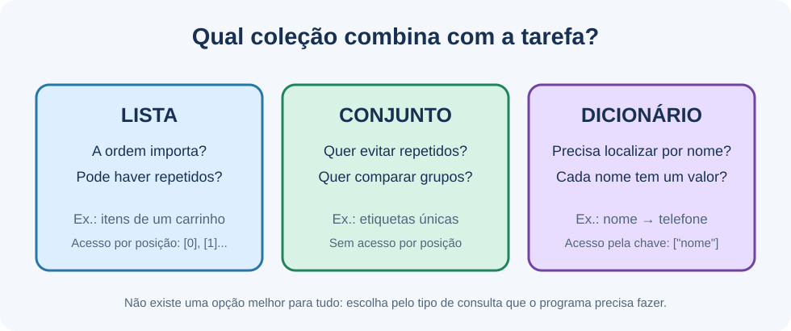
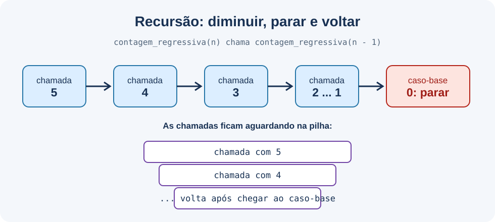
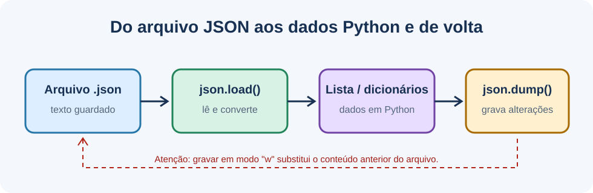

# Conceitos de algoritmos e estruturas de dados

Este guia complementa [Fundamentos de Python](../Fundamentos/FUNDAMENTOS.md): aqui o foco é escolher e compreender a estrutura usada para representar os dados, e não apenas a sintaxe da linguagem.

## 1. Algoritmo e estrutura de dados

Um algoritmo é uma sequência finita de passos que transforma uma entrada em uma saída. A estrutura de dados define como as informações ficam organizadas na memória e quais operações são convenientes. A escolha depende do que o programa precisa fazer com frequência: acessar por posição, buscar por chave, evitar duplicatas, inserir ou remover elementos.

## 2. Coleções básicas

| Estrutura | Organização | Acesso/uso típico | Exemplo no repositório |
| --- | --- | --- | --- |
| Lista (`list`) | Sequência ordenada e mutável; aceita repetidos | Acesso por índice e percurso | [`listas.py`](../../src/LISTAS/listas.py) |
| Conjunto (`set`) | Elementos únicos; sem índices | Pertinência e operações de conjuntos | [`sets.py`](<../../src/DICIONÁRIOS E SETS/sets.py>) |
| Dicionário (`dict`) | Pares de chave e valor | Consulta de valor por chave | [`dicioanrios-listas.py`](<../../src/DICIONÁRIOS E SETS/dicioanrios-listas.py>) |

Um dicionário mutável não pode ser elemento de um conjunto nem chave de outro dicionário. Para armazenar vários registros compostos, use, por exemplo, uma lista de dicionários. Um conjunto não promete uma ordem de exibição; ordene explicitamente com `sorted()` quando a ordem for necessária.

### Uma pergunta simples para escolher

- Escolha **lista** quando a sequência dos itens importa, quando há repetidos ou quando você quer consultar pelo número da posição.
- Escolha **conjunto** quando o importante é manter cada valor uma única vez ou comparar quais itens existem em dois grupos. Não conte com posições nem ordem de impressão.
- Escolha **dicionário** quando cada informação tem um nome que serve para encontrá-la, como `"cidade"` ou `"telefone"`.
- Use **lista de dicionários** quando precisa guardar vários registros com campos nomeados, como uma lista de times, cada um com nome e cidade.

É possível combinar estruturas. A decisão não precisa ser "uma coleção para tudo": uma lista pode guardar dicionários; um dicionário pode guardar uma lista. Pense primeiro nas perguntas que o programa vai fazer aos dados.

## 3. Lista sequencial e lista ligada

Uma lista Python armazena uma sequência que pode ser acessada diretamente por índice. Inserir ou remover no início/meio pode exigir deslocar outros elementos. Em uma lista ligada, cada nó aponta para o próximo; uma lista duplamente ligada também aponta para o anterior. Para encontrar uma posição ou valor, é necessário seguir as referências nó a nó.

| Operação | Lista Python | Lista simplesmente ligada deste projeto | Lista duplamente ligada deste projeto |
| --- | --- | --- | --- |
| Acesso por índice | O(1) | Não implementado diretamente; percurso O(n) | Não implementado diretamente; percurso O(n) |
| Busca por valor | O(n) | O(n) | O(n) |
| Inserção no final | `append()`: O(1) amortizado | O(n), percorre desde a cabeça | O(1), mantém referência à cauda |

Os custos descrevem o crescimento esperado do trabalho à medida que a quantidade de elementos aumenta, não um tempo em segundos. Veja [`listas-simples-ligadas.py`](<../../src/LISTAS LIGADAS/listas-simples-ligadas.py>) e [`listas-duplamente-ligadas.py`](<../../src/LISTAS LIGADAS/listas-duplamente-ligadas.py>).

Uma lista Python pode ser comparada a gavetas numeradas em sequência: sabendo o número da gaveta, você vai direto até ela. Numa lista ligada, cada bilhete informa onde está o próximo; para encontrar o quinto, você passa pelo primeiro, segundo, terceiro e quarto. A lista ligada é útil para estudar referências e conexões, mas não é automaticamente melhor que a lista Python: a melhor escolha depende das operações necessárias.

Ao alterar uma lista ligada, não basta apagar o objeto da memória. É preciso mudar a referência que levava até ele. Se um nó do meio é removido, o anterior deve apontar para o próximo; na lista dupla, o próximo também deve apontar para o anterior. Os casos de lista vazia e remoção da cabeça ou da cauda precisam de cuidado especial.

## 4. Pilha e fila

Uma **pilha** segue LIFO (*Last In, First Out*): o último item inserido é o primeiro removido. `push` insere no topo; `pop` remove e devolve o topo; `peek` consulta o topo sem removê-lo. O exemplo usa `collections.deque` como armazenamento. O diagrama mostra a ordem dessas operações:

Uma **fila** normalmente segue FIFO (*First In, First Out*): o primeiro elemento inserido é o primeiro removido. Embora o diretório se chame `PILHA E FILA`, o repositório ainda não contém um exemplo de fila.

Uma fila lembra uma fila de atendimento: pessoas entram no final e a próxima pessoa atendida sai do começo. Já a pilha lembra uma pilha de pratos: o último colocado fica por cima e é o primeiro que pode ser retirado. O nome dessas regras indica a ordem em que os elementos saem; não descreve uma fila ou uma pilha física.

No código da pilha, `deque` é o recipiente usado por baixo. A classe `Pilha` oferece nomes que explicam as ações (`push`, `pop`, `peek`) e impede a remoção/leitura de uma pilha vazia com um erro explícito.

## 5. Recursão e pilha de execução

Uma função recursiva resolve partes menores do mesmo problema. O caso-base interrompe a recursão; o caso recursivo deve reduzir ou simplificar a entrada. Cada chamada pendente ocupa espaço na pilha de chamadas do Python. Portanto, recursão sem progresso até o caso-base pode exceder o limite de chamadas.

- [`recursao.py`](<../../src/RECURSÃO/recursao.py>) faz contagem regressiva até o caso-base.
- [`caso-base.py`](<../../src/RECURSÃO/caso-base.py>) abre bonecas de forma recursiva.
- [`caso-recursivo.py`](<../../src/RECURSÃO/caso-recursivo.py>) percorre uma árvore de departamentos e calcula valores.
- [`pilha-de-chamads.py`](<../../src/RECURSÃO/pilha-de-chamads.py>) encadeia funções para ilustrar chamadas aninhadas.
- [`pilha-recursiva.py`](<../../src/RECURSÃO/pilha-recursiva.py>) consulta categorias e subcategorias; apesar do nome, não é uma função recursiva.

Na figura, cada número representa uma chamada que ainda não terminou. Quando a chamada chega ao zero, ela para de criar novas chamadas. Depois a execução retorna pelas chamadas que estavam aguardando. Essa pilha de execução é controlada pelo Python; não é a mesma estrutura que o programa cria com a classe `Pilha`.

No exemplo da árvore de departamentos, cada departamento pode conter outros departamentos. A função calcula o total do departamento atual e chama a si mesma para cada subdivisão. É um uso natural da recursão: a mesma regra funciona para o todo e para cada parte menor.

## 6. Notação O

A notação O descreve como o custo de um algoritmo cresce em função da entrada `n`, abstraindo detalhes de máquina:

- **O(1):** custo constante, como acessar um índice válido de uma lista.
- **O(log n):** crescimento logarítmico; a cada etapa, reduz-se substancialmente o espaço de busca.
- **O(n):** crescimento linear, como percorrer uma lista para procurar um valor.
- **O(n²):** crescimento quadrático, comum quando cada item é comparado com todos os demais por dois laços aninhados.

Esses exemplos são referências gerais, não uma promessa de desempenho absoluto. Para estruturas e operações concretas deste repositório, consulte a tabela de custos em [Fundamentos](../Fundamentos/FUNDAMENTOS.md).

### Como entender a notação sem medir segundos

Imagine comparar o trabalho com uma lista pequena e outra cem vezes maior:

- **O(1), constante:** a operação faz aproximadamente o mesmo número de passos, como pegar diretamente um item pela posição conhecida.
- **O(n), linear:** pode ser necessário olhar cada item. Mais itens costumam significar proporcionalmente mais verificações.
- **O(n²), quadrático:** para cada item, outro percurso pode olhar muitos itens. Se dobrar a quantidade, o trabalho pode crescer perto de quatro vezes.
- **O(log n), logarítmico:** cada passo reduz a busca, por exemplo pela metade. É o que pode acontecer ao procurar em uma lista ordenada usando busca binária; esse algoritmo não está implementado nos exemplos atuais.

Em `O(n)`, a letra `n` representa a quantidade de dados. A notação ignora detalhes como modelo do computador, linguagem e pequenas diferenças entre comandos. Serve para comparar como soluções tendem a crescer quando recebem mais dados.

Dois laços aninhados nem sempre significam O(n²): é preciso olhar quantas vezes cada laço repete e qual tamanho de entrada cada um percorre. Mas quando ambos percorrem todos os `n` itens, o total pode se aproximar de `n × n`.

## 7. JSON: carregar e salvar um arquivo

O exercício [`json-exemplo.py`](<../../src/DICIONÁRIOS E SETS/json-exemplo.py>) lê o arquivo `brasileirao.json` que está na mesma pasta do script. O desenho resume o caminho:

1. `Path(__file__).with_name(...)` encontra o arquivo ao lado do script, mesmo que o comando tenha sido iniciado em outra pasta.
2. `with ... open("r")` abre para leitura e fecha o arquivo ao terminar o bloco.
3. `json.load()` converte o texto JSON em listas e dicionários Python.
4. O programa percorre os registros, procura os dados e atualiza a lista de títulos do Palmeiras.
5. `with ... open("w")` abre para gravação; `json.dump()` transforma os dados de volta em JSON.

O passo 5 substitui o conteúdo existente. O exercício verifica se o título que acrescenta já está na lista para não duplicá-lo em execuções repetidas, mas ainda grava o arquivo. Faça uma cópia do JSON antes de experimentar mudanças que queira preservar.

O script se chama `json-exemplo.py`, e não `json.py`, para que o nome local não esconda o módulo padrão `json` quando Python tentar importá-lo.

## 8. Como navegar pelos exemplos

| Se quer entender... | Comece por... | Depois experimente... |
| --- | --- | --- |
| Posições numa sequência | `src/LISTAS/listas.py` | `tamanho-listas.py`, `adicionar-elementos.py` e `remover.py` |
| Repetir instruções | `src/LISTAS/loop-for.py` | `operacoes-com-listas.py` e `matrizes.py` |
| Escolher entre grupos e fichas | `src/DICIONÁRIOS E SETS/sets.py` | `dicioanrios-listas.py` e `json-exemplo.py` |
| Guardar itens por ordem de saída | `src/PILHA E FILA/pilhas.py` | Observe o caso de pilha vazia e o método `peek()` |
| Conectar elementos | `src/LISTAS LIGADAS/listas-simples-ligadas.py` | Compare com `listas-duplamente-ligadas.py` |
| Resolver um problema em chamadas menores | `src/RECURSÃO/recursao.py` | Compare o caso-base com a árvore em `caso-recursivo.py` |

## 9. Palavras que aparecem nos exemplos

| Palavra | Significado em linguagem simples |
| --- | --- |
| **Algoritmo** | Uma receita de passos para transformar uma entrada em um resultado. |
| **Coleção** | Um lugar para guardar vários valores, como uma lista ou um dicionário. |
| **Índice** | O número que indica a posição de um item numa lista; começa em zero. |
| **Chave** | O nome usado para encontrar um valor dentro de um dicionário. |
| **Mutável** | Algo que pode ser alterado depois de criado. Uma lista é mutável. |
| **Método** | Uma ação ligada a um objeto; por exemplo, `frutas.append("uva")` acrescenta um item à lista. |
| **Nó** | Uma peça de uma lista ligada: guarda um dado e uma ou mais ligações para outras peças. |
| **Referência** | Uma ligação que permite encontrar outro objeto, como a ligação de um nó ao próximo. |
| **Caso-base** | A regra que faz uma função recursiva parar de chamar a si mesma. |
| **Pilha de chamadas** | A lista interna de tarefas que Python ainda precisa terminar quando funções chamam outras funções. |
| **JSON** | Um formato de texto para guardar informações de forma organizada e trocar esses dados entre programas. |
| **O(n)** | Uma forma curta de dizer que o trabalho pode crescer junto com a quantidade de itens `n`. |

Quando surgir outra palavra nova, use os exemplos como contexto: observe que dado entra, qual ação é feita e qual resultado sai. O objetivo não é decorar nomes, mas conseguir explicar o que o programa faz.
