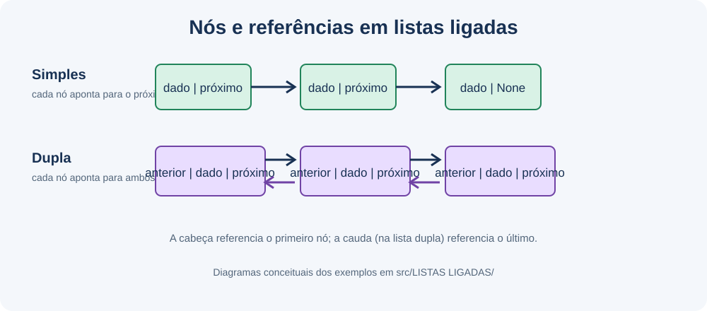
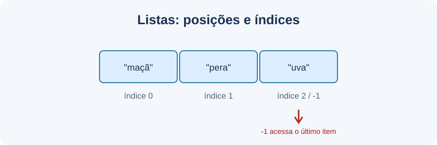

<div align="center">

# 🐍 Algoritmos e Estruturas de Dados com Python

**Um espaço de estudos práticos para aprender Python e entender como os dados se organizam.**

Exemplos comentados • conceitos fundamentais • estruturas de dados

<br>


</div>

---

## 👋 Sobre o projeto

Este repositório reúne exercícios introdutórios de **Python**, **algoritmos** e **estruturas de dados**. A proposta é aprender pela leitura e experimentação: cada exemplo mostra uma ideia pequena, e os comentários no código ajudam a entender a sintaxe, as operações e a lógica utilizada.

É um projeto de estudos em evolução — não um pacote pronto para produção. Alguns exercícios ainda têm limitações conhecidas, que estão descritas com transparência neste README para que iniciantes possam reconhecê-las e praticar a correção.

### O que você vai encontrar

| Fundamentos de Python | Estruturas de dados |
| --- | --- |
| Variáveis, tipos e operadores | Listas e matrizes |
| Condições e laços `for` / `while` | Conjuntos e dicionários |
| Funções, classes, métodos e `self` | Pilha com `deque` |
| Listas de compreensão e f-strings | Listas simplesmente e duplamente ligadas |
| Arquivos e módulo `json` | Busca, inserção e remoção |

## 🧭 Trilha de aprendizagem

Uma ordem sugerida para explorar o conteúdo:

1. **Conheça as sequências:** [listas e índices](src/LISTAS/listas.py), [tamanho](src/LISTAS/tamanho-listas.py), [adição](src/LISTAS/adicionar-elementos.py) e [remoção](src/LISTAS/remover.py).
2. **Pratique a lógica:** [laço `for`](src/LISTAS/loop-for.py), [operações e filtros](src/LISTAS/operacoes-com-listas.py), [matrizes](src/LISTAS/matrizes.py) e [entrada interativa](src/LISTAS/adcionar.py).
3. **Explore coleções:** [conjuntos (`set`)](src/DICION%C3%81RIOS%20E%20SETS/sets.py), [dicionários](src/DICION%C3%81RIOS%20E%20SETS/dicionarios.py), [listas de dicionários](src/DICION%C3%81RIOS%20E%20SETS/dicioanrios-listas.py) e [JSON](src/DICION%C3%81RIOS%20E%20SETS/json.py).
4. **Entenda estruturas ligadas:** [pilha LIFO](src/PILHA%20E%20FILA/pilha.py), [lista simplesmente ligada](src/LISTAS%20LIGADAS/listas-simples-ligadas.py) e [lista duplamente ligada](src/LISTAS%20LIGADAS/listas-duplamente-ligadas.py).
5. **Aprofunde os conceitos:** leia [Fundamentos de Python e estruturas de dados](Docs/Fundamentos/FUNDAMENTOS.md) e use os diagramas desta página como apoio visual.

> **Dica para iniciantes:** leia primeiro os comentários, execute um exemplo por vez e experimente alterar os dados de entrada. Quando um arquivo tiver uma limitação conhecida, consulte [Antes de executar todos os exemplos](#-antes-de-executar-todos-os-exemplos).

## 🗺️ Organização do repositório

```text
.
├── README.md
├── Docs/
│   ├── Conceitos/
│   │   └── img/                 # Diagramas conceituais em SVG
│   └── Fundamentos/
│       └── FUNDAMENTOS.md       # Guia de sintaxe e estruturas
└── src/
    ├── DICIONÁRIOS E SETS/      # set, dict, JSON e dados de exemplo
    ├── LISTAS/                  # listas, matrizes, iteração e operações
    ├── LISTAS LIGADAS/          # listas simplesmente e duplamente ligadas
    └── PILHA E FILA/            # exemplo de pilha com deque
```

### Índice completo dos exemplos

<details>
<summary><strong>Listas, matrizes e controle de fluxo</strong></summary>

| Exemplo | Conceitos |
| --- | --- |
| [`listas.py`](src/LISTAS/listas.py) | Listas, tipos, índices, `print()`, f-strings e `type()` |
| [`tamanho-listas.py`](src/LISTAS/tamanho-listas.py) | `len()`, índices e `while` |
| [`adicionar-elementos.py`](src/LISTAS/adicionar-elementos.py) | `append()`, `insert()` e `extend()` |
| [`remover.py`](src/LISTAS/remover.py) | `del`, `pop()`, `remove()`, `in` e `while` |
| [`loop-for.py`](src/LISTAS/loop-for.py) | Laço `for` e `range()` |
| [`operacoes-com-listas.py`](src/LISTAS/operacoes-com-listas.py) | Compreensão de listas, filtros, operadores e laços aninhados |
| [`matrizes.py`](src/LISTAS/matrizes.py) | Listas de listas e índices de linha/coluna |
| [`adcionar.py`](src/LISTAS/adcionar.py) | Entrada do usuário, condições, `break` e recibo |

</details>

<details>
<summary><strong>Conjuntos, dicionários e JSON</strong></summary>

| Exemplo | Conceitos |
| --- | --- |
| [`sets.py`](<src/DICIONÁRIOS E SETS/sets.py>) | Conjuntos, união, interseção e diferenças |
| [`dicionarios.py`](<src/DICIONÁRIOS E SETS/dicionarios.py>) | Dicionários e acesso por chave |
| [`dicioanrios-listas.py`](<src/DICIONÁRIOS E SETS/dicioanrios-listas.py>) | Lista de dicionários, iteração e f-strings |
| [`json.py`](<src/DICIONÁRIOS E SETS/json.py>) | Leitura e gravação de dados JSON |
| [`brasileirao.json`](<src/DICIONÁRIOS E SETS/brasileirao.json>) | Dados usados pelo exercício de JSON |

</details>

<details>
<summary><strong>Pilhas e listas ligadas</strong></summary>

| Exemplo | Conceitos |
| --- | --- |
| [`pilha.py`](<src/PILHA E FILA/pilha.py>) | Classe, `__init__`, `self`, métodos e pilha LIFO |
| [`listas-simples-ligadas.py`](<src/LISTAS LIGADAS/listas-simples-ligadas.py>) | Nós, referências, busca, inserção e remoção |
| [`listas-duplamente-ligadas.py`](<src/LISTAS LIGADAS/listas-duplamente-ligadas.py>) | Referências anterior/próximo, cabeça e cauda |

</details>

## 🖼️ Conceitos em imagens

Os diagramas são **ilustrações conceituais** das estruturas, não capturas de tela de programas em execução.

<details>
<summary><strong>Ver diagrama da pilha (LIFO)</strong></summary>
<br>


</details>

<details>
<summary><strong>Ver diagrama das listas ligadas</strong></summary>
<br>



</details>

<details>
<summary><strong>Ver diagrama dos índices de uma lista</strong></summary>
<br>



</details>

## 🚀 Comece a praticar

### Requisitos

- Python 3 instalado.
- Terminal aberto na pasta raiz do repositório.
- Não há dependências externas declaradas para os exemplos documentados. O código usa módulos da biblioteca padrão, como `collections` e `json`.

### Executar um exemplo

No PowerShell:

```powershell
python --version
python "src\LISTAS\loop-for.py"
```

Outro exemplo, que demonstra uma classe de pilha:

```powershell
python "src\PILHA E FILA\pilha.py"
```

Execute **um arquivo por vez**: cada exercício é independente. O exemplo [`adcionar.py`](src/LISTAS/adcionar.py) pede que você digite produtos no terminal; informe `0` para encerrar a entrada.

## ⚠️ Antes de executar todos os exemplos

Os exemplos refletem o estado atual do material de estudo. Alguns contêm trechos incompletos ou erros conhecidos; os avisos abaixo servem para evitar confusão ao executar:

| Arquivo | O que observar |
| --- | --- |
| [`dicionarios.py`](<src/DICIONÁRIOS E SETS/dicionarios.py>) | O literal tenta usar dicionários dentro de um conjunto. Dicionários são mutáveis e não podem ser elementos de um conjunto; a expressão falha antes do acesso por chave. |
| [`json.py`](<src/DICIONÁRIOS E SETS/json.py>) | `json.load()` devolve os dados, não o arquivo. Assim, `dados.close()` não fecha o arquivo. Além disso, `append()` modifica a lista e retorna `None`; atribuir esse retorno à chave deixa seu valor como `None`. O caminho do JSON é relativo ao diretório de execução. |
| [`adicionar-elementos.py`](src/LISTAS/adicionar-elementos.py) | Listas não têm método `push()`. A chamada gera `AttributeError` e interrompe o script nesse ponto. |
| [`tamanho-listas.py`](src/LISTAS/tamanho-listas.py) | `i` não é inicializada e `t_numeros` é um inteiro; portanto, o acesso `t_numeros[i]` não funciona. |
| [`sets.py`](<src/DICIONÁRIOS E SETS/sets.py>) | Os nomes `ordered_ascending`/`ordered_descending` não correspondem aos valores de `reverse`: `True` indica ordem reversa (decrescente). |

Esses pontos estão documentados para fins didáticos; este README não afirma que os exemplos foram corrigidos.

## 📚 Documentação

- **[Fundamentos de Python e estruturas de dados](Docs/Fundamentos/FUNDAMENTOS.md):** variáveis, tipos, operadores, listas, conjuntos, dicionários, condições, laços, funções, classes, arquivos e complexidade intuitiva.
- **Comentários no código:** os 15 arquivos `.py` em `src/` incluem explicações em português das sintaxes e operações estudadas.
- **Diagramas:** os SVGs em `Docs/Conceitos/img/` ajudam a visualizar pilhas, listas ligadas e índices.

## 🎯 Objetivos de aprendizagem

Ao explorar os exemplos, a pessoa iniciante pode praticar como:

- Ler e escrever sintaxe Python básica, com indentação, variáveis, expressões e chamadas.
- Usar coleções e escolher entre sequência, conjunto e dicionário.
- Percorrer dados com laços e filtrá-los com condições.
- Representar estruturas de dados com nós e referências.
- Relacionar o código a diagramas e explicar operações de inserção, busca e remoção.

## 🔄 Atualização da documentação

Quando novos exemplos forem adicionados ou os atuais forem alterados, o índice, os conceitos e os avisos desta página e de [Fundamentos](Docs/Fundamentos/FUNDAMENTOS.md) devem acompanhar o código. Não há monitoramento automático do repositório em segundo plano; durante futuras alterações solicitadas nesta conversa, a documentação poderá ser atualizada junto com a implementação.

---

<div align="center">

Feito para estudar, experimentar e aprender um conceito de cada vez. 🌱

</div>
